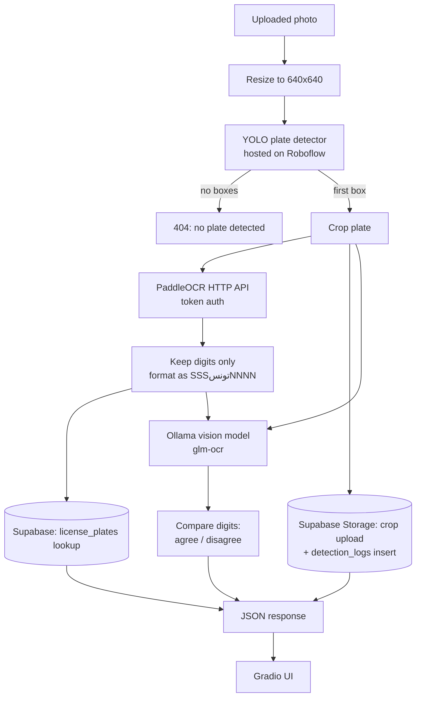

# Tunisian License Plate Reader

Upload a photo of a car, get back the Tunisian plate number, the registered driver from Supabase, and a second opinion from a local vision model.

[](https://github.com/kernelbits/TnLicencePlateReader/actions/workflows/ci.yml)

Built during an internship at ITGate (2026). A FastAPI backend runs the pipeline, a Gradio app is the front end, and the whole thing runs locally with Docker Compose. The training and labelling data lives in a separate repo: [TunisianLicencePlatesDataset](https://github.com/kernelbits/TunisianLicencePlatesDataset).

## How it works



1. The image is resized to 640x640 and sent to a YOLO detector hosted on Roboflow. Only the first detected box is used.
2. The box is cropped and sent as base64 to a PaddleOCR endpoint.
3. Only the digits of the OCR text are kept. The first three and last four form the plate, `SSSتونسNNNN` (for example `125تونس8365`).
4. The plate is looked up in the Supabase `license_plates` table. The crop is uploaded to a storage bucket and a row is written to `detection_logs`. Both steps are non-fatal if they fail.
5. A local vision model (through Ollama) gets the crop and the OCR result. It is asked for the digits and the backend reports whether they agree. This is advisory: the returned `plate_number` always comes from PaddleOCR.

A separate `/chat` endpoint takes a natural-language question. A local LLM turns it into a JSON query spec, the backend runs it against Supabase, and the LLM summarises the rows.

## Features

- **Plate detection** with a YOLO model served by Roboflow (weights are not in this repo).
- **Text extraction** with PaddleOCR behind an HTTP endpoint (up to 3 attempts).
- **Plate normalisation** to the Tunisian `series + تونس + number` format.
- **Driver lookup** in Supabase, plus crop storage and a detection log.
- **Local LLM validation** of the OCR result with an Ollama vision model.
- **Natural-language chat endpoint** (`POST /chat`) over the Supabase tables. It has no UI yet; the Gradio app only calls `/detect`.
- **Docker Compose** setup with backend, frontend and Ollama services.

## Tech stack

- **Backend:** Python 3.11, FastAPI, Uvicorn, Pydantic
- **Frontend:** Gradio
- **Computer vision:** YOLO detection via the Roboflow SDK, Pillow
- **OCR:** PaddleOCR over HTTP
- **LLMs:** Ollama (`llama3.2:3b` for chat, `glm-ocr` for vision validation)
- **Data:** Supabase (Postgres tables and Storage)
- **Tooling:** Docker Compose, pytest, GitHub Actions

## Setup

### 1. Configuration

Create a `.env` file in the project root. Never commit it; it is git-ignored.

| Variable | Used by | Required | Purpose |
| --- | --- | --- | --- |
| `RF_API_KEY` | backend, scripts | yes | Roboflow API key |
| `OCR_API_URL` | backend | yes | PaddleOCR endpoint |
| `OCR_TOKEN` | backend | yes | Token sent to the OCR endpoint |
| `SUPABASE_URL` | backend | for DB features | Supabase project URL |
| `SUPABASE_ANON_KEY` | backend | for DB features | Supabase anon key (used if no service-role key is set) |
| `SUPABASE_SERVICE_ROLE_KEY` | backend | optional | Preferred key when set. It bypasses row-level security, so keep it server-side only |
| `OLLAMA_API_URL` | backend | optional | Defaults to `http://localhost:11434/api/generate` |
| `BACKEND_URL` | frontend | optional | Defaults to `http://127.0.0.1:8000`. Set it in the shell, because the frontend does not read `.env` |

The Supabase project needs a `license_plates` table, a `detection_logs` table (`id`, `plate_number`, `image_url`, `created_at`) and a storage bucket named `plates`. The schema the chat endpoint expects is in `backend/backend.py`.

### 2. Python environment (local run)

```bash
python -m venv .venv
source .venv/bin/activate        # Windows: .venv\Scripts\activate
pip install -r requirements.txt
pip install -r frontend/requirements.txt
```

### 3. Ollama (optional, for chat and vision validation)

1. Install Ollama from [ollama.com](https://ollama.com).
2. Pull the models the code uses:
   ```bash
   ollama pull llama3.2:3b
   ollama pull glm-ocr
   ```
3. Make sure Ollama is running. If it is not, `/detect` still works and reports the vision result as an error, but `/chat` returns 503.

## Usage

Start the backend from the project root:

```bash
python -m uvicorn backend.backend:app --reload --host 0.0.0.0 --port 8000
```

Then start the frontend in a second terminal:

```bash
BACKEND_URL=http://127.0.0.1:8000 python frontend/main.py
```

Open the Gradio URL it prints (default `http://127.0.0.1:7860`), upload a car photo, and click **Detect Plate & Annotate**.

The API is also available at `http://localhost:8000/docs`:

- `POST /detect` with a multipart field named `image`
- `POST /chat` with JSON `{"message": "...", "context_plate": null, "history": null}`

## Docker

```bash
docker compose up --build
```

- Backend: http://localhost:8000
- Frontend (Gradio): http://localhost:7860
- Ollama: http://localhost:11434

The first time, pull the models into the Ollama container:

```bash
docker compose exec ollama ollama pull llama3.2:3b
docker compose exec ollama ollama pull glm-ocr
```

To use an Ollama server you already run, remove the `ollama` service from `docker-compose.yml` and set `OLLAMA_API_URL` to its `/api/generate` URL.

**Known issue:** the backend image copies a `data/` folder (`COPY data /app/data`), but `data/` is git-ignored and not in the repo. On a fresh clone, create a `data/` directory (it can be empty) before building.

## Tests

The tests cover the backend API and run without network access, GPU, model weights, Ollama, Roboflow or Supabase. Roboflow and Supabase are replaced with stand-ins, and the PaddleOCR and Ollama HTTP calls are mocked.

```bash
pip install -r requirements-test.txt
pytest
```

They check the plate formatting, the OCR-to-plate digit logic, the vision agree/disagree result, error responses (404, 422, 503), the chat query path and the storage filename sanitisation. The frontend and the standalone scripts are not covered.

## Project structure

```
backend/
  backend.py            FastAPI app: /detect, /chat and the pipeline helpers
  Dockerfile
  requirements.txt      Lists easyocr, which no current image installs
frontend/
  main.py               Gradio UI that calls the backend
  Dockerfile
  requirements.txt
tests/
  conftest.py           Stubs Roboflow/Supabase and pins the environment
  test_backend.py       API tests with mocked external services
plateReader.py          Standalone Roboflow detection check (writes predictions/)
crop_plates.py          Batch-crops plates from data/ into cropped_plates/
upload_data.py          Uploads YOLO-format images and labels to Roboflow
docker-compose.yml      backend, frontend and ollama services
requirements.txt        Backend and shared dependencies
requirements-test.txt   Test dependencies
pytest.ini
```

`crop_plates.py` deletes each source image from `data/` after cropping it, so run it on a copy.

## Design decisions

- **Detection is hosted on Roboflow.** The model can be updated server-side without touching this code, and the repo stays free of large weight files.
- **OCR is a separate HTTP service.** PaddleOCR runs behind an endpoint with token auth. The backend only sends a crop and reads text, so the OCR service can be scaled or swapped without changing the API.
- **Digits are the only signal kept.** Tunisian plates are a series, the Arabic word for Tunisia, and a number. The OCR output is noisy (Latin and Arabic text, separators), so only digits are kept and then formatted into the fixed layout.
- **LLM validation is a second reader, not the decider.** OCR confusion between similar digits is the main expected error. A vision model on the same crop gives an independent reading. The response reports agreement but does not change the answer. If Ollama is down, detection still returns a result with an error field.
- **Local LLMs for language tasks.** Chat and validation go to Ollama on the same machine. The Roboflow and OCR calls still go to external services.
- **The LLM never runs SQL.** For chat, the model only produces a JSON query spec. The backend runs it with a fixed set of operators (`eq`, `neq`, `gt`, `lt`, `gte`, `lte`, `like`, `ilike`).
- **Failures are contained.** Roboflow and OCR calls make up to 3 attempts, 5 seconds apart. Logging and storage failures do not fail the request.
- **Frontend and backend are separate.** The Gradio app talks to the backend over HTTP, so other clients can use the same API.

## Limitations

- **Only the first detection is used.** The code takes `predictions[0]` and does not sort by confidence.
- **Short OCR reads are padded silently.** If the OCR text has fewer than four or three digits, `zfill` pads it with zeros. The result looks like a valid plate but may be wrong. Nothing flags this.
- **The vision check is not measured.** It is a second opinion from a small local model. This repo contains no accuracy figures for detection, OCR or validation.
- **No authentication.** `/detect` and `/chat` have no auth, and each `/detect` call uses Roboflow and OCR quota.
- **The LLM chooses the table and columns in chat.** The backend does not whitelist table or column names, so the Supabase key's permissions are the only limit. A service-role key widens that. Use a read-only key or add a whitelist before exposing this.
- **No default row limit on chat queries.** The prompt asks for a default of 10, but the code applies a limit only when the model supplies one.
- **Hard-coded Roboflow project.** The workspace, project name and model version are constants in `backend/backend.py` and the scripts.
- **Shared temp file in the frontend.** `frontend/main.py` writes to `temp_upload.jpg` in the working directory, so concurrent uploads can collide.

## Next steps

- Measure detection, OCR and validation accuracy on a labelled hold-out set from the dataset repo.
- Add authentication and a table/column whitelist for the chat endpoint.
- Sort detections by confidence and add a check on the digit count before formatting.
- Move the Roboflow settings into environment variables.
- Pin dependency versions and split the backend requirements from the Gradio ones.
- Add a Docker build job to CI.
